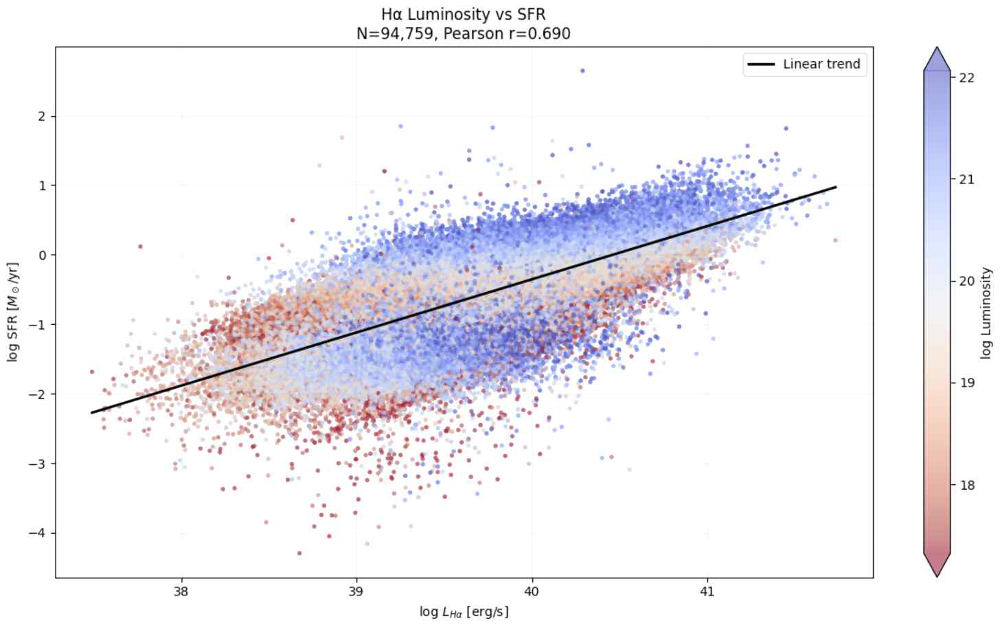
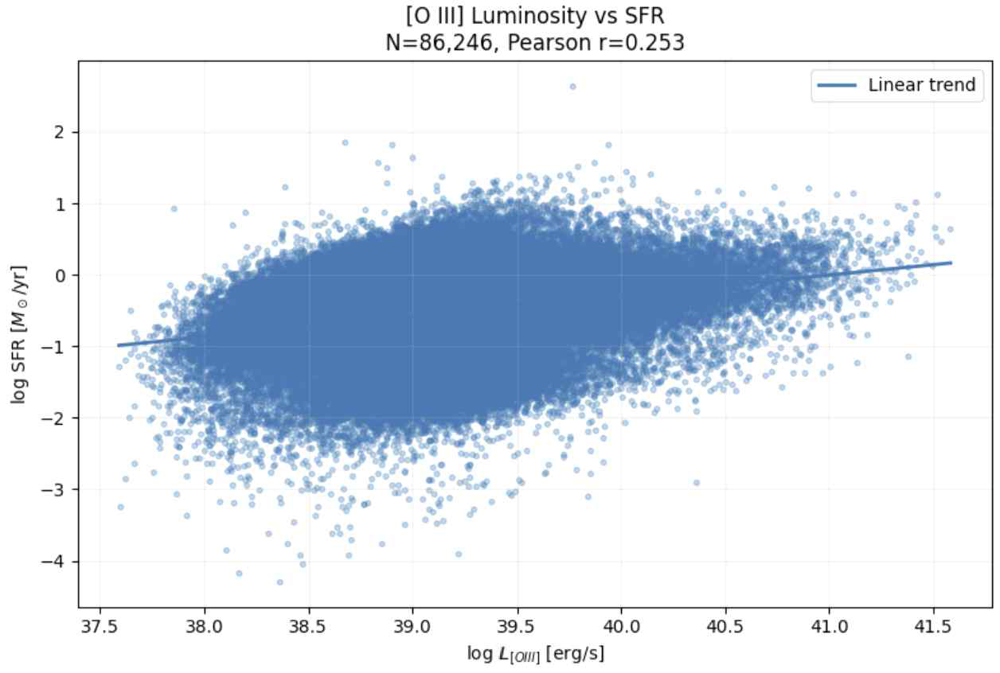
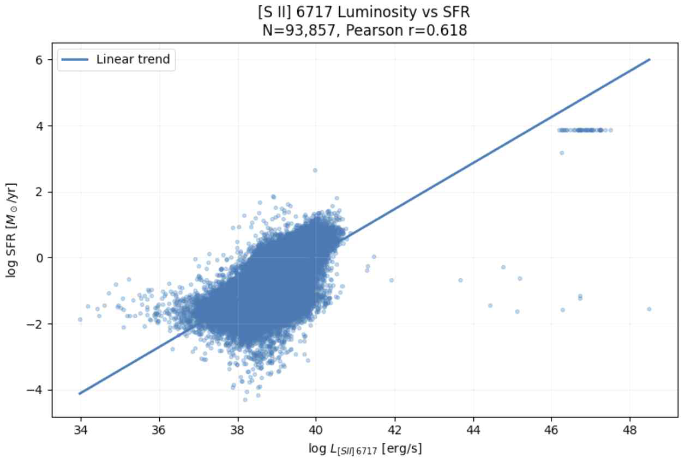
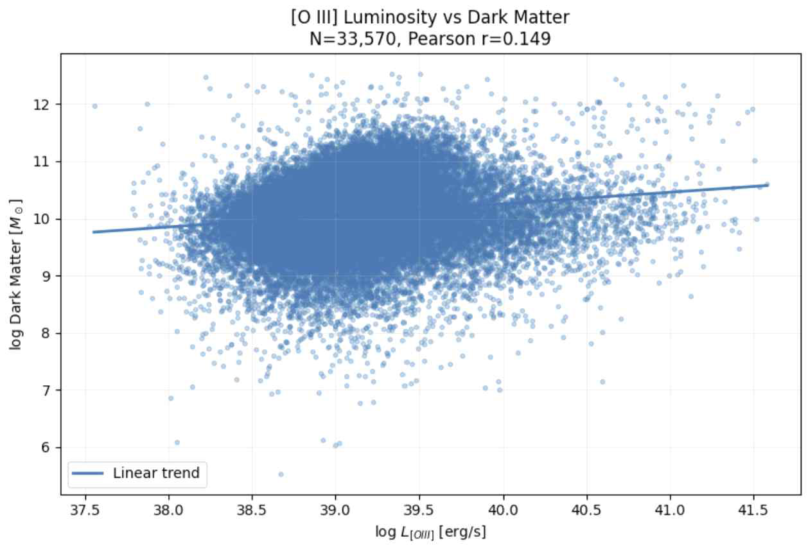
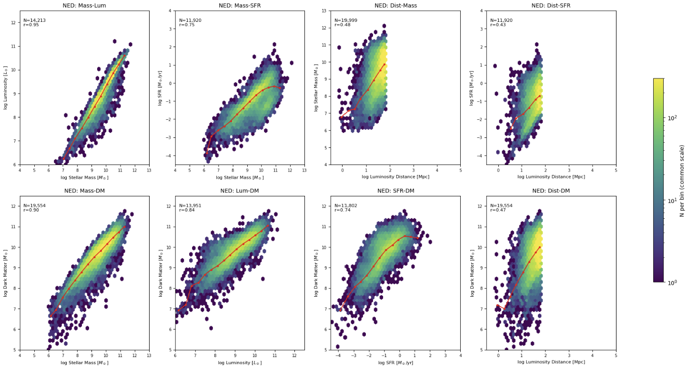
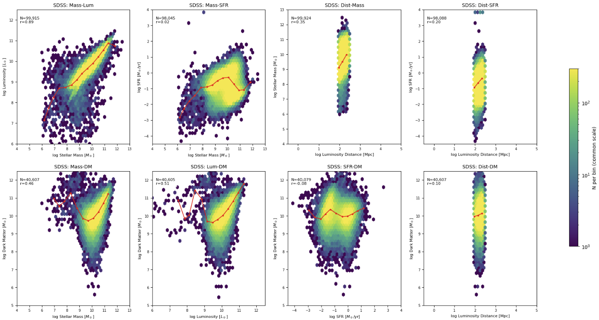
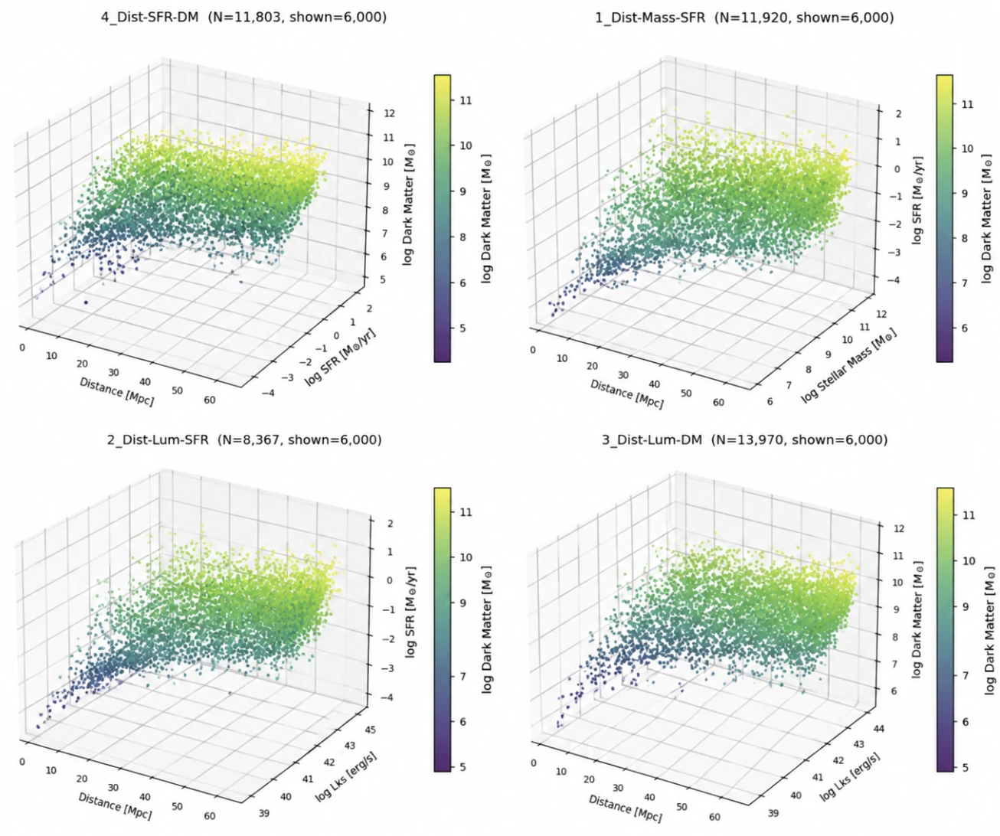
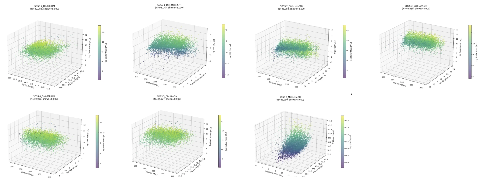
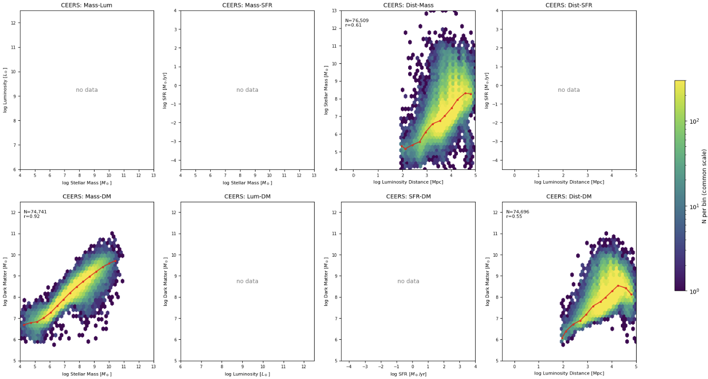
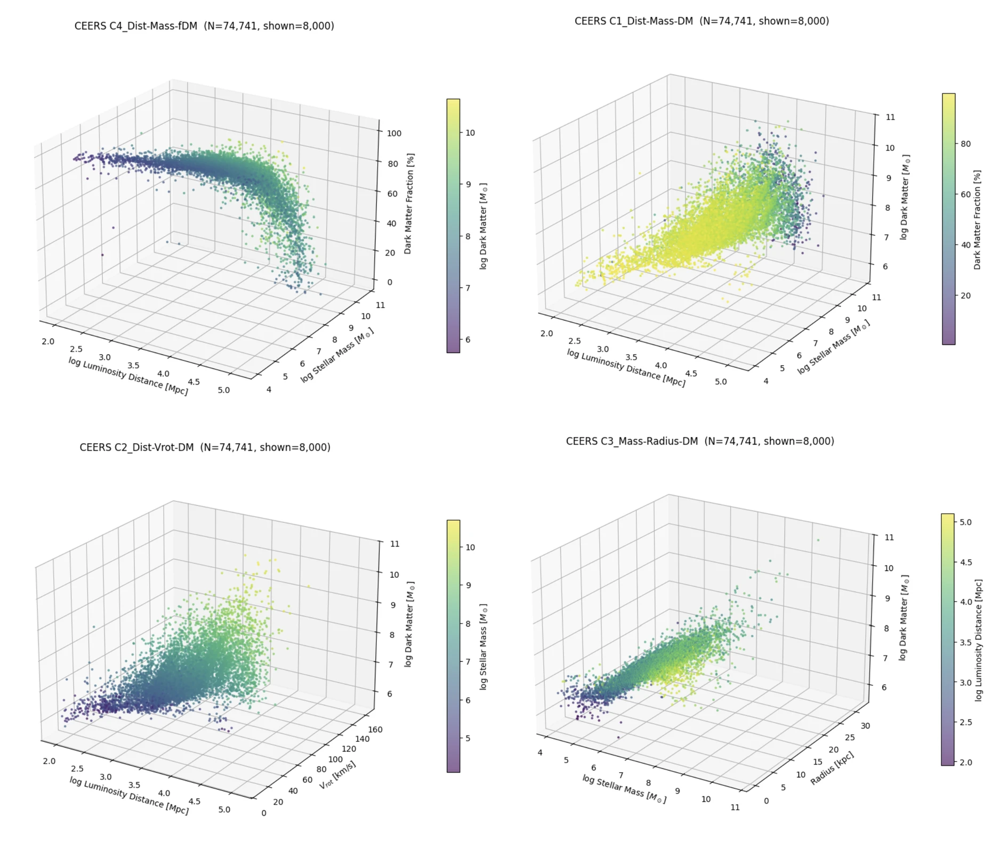

# 은하 진화 지수 GEI v3 종합 해설서 — 말름퀴스트 편향 보정 · 은하의 과거와 미래 규명 · 가중치 수학적 도출 · 형태 분류 및 카탈로그 보정

## 초록

본 연구는 국소 우주부터 초기 우주까지 세 개의 대규모 은하 카탈로그 — **NED-LVS**(약 145만 개), **SDSS DR18**(5만 개), **JWST CEERS**(7만 7천 개) — 를 수집·정제하여, 항성질량($M_*$)·광도($L$)·별생성률($\text{SFR}$)·비별생성률($\text{sSFR}$)·암흑물질 질량($M_{\text{DM}}$)·이온화 방출선 광도($L_{\text{H}\alpha}, L_{[\text{S II}]\,6717}, L_{[\text{O III}]}$)·거리($D$) 사이의 2차원·3차원 상관관계를 분석하고, 이를 바탕으로 개별 은하의 진화 단계와 과거·미래 진화 궤적을 정량 판별하는 **은하 진화 지수(GEI v3)** 및 두 개의 웹 분석 프로그램(**은하 형태·분광 분석기**, **천문대 관측 은하 진화 분석기**)을 제작하였다.

1. **은하 형태·분광 분석기**([`galaxy_analyzer_web.html`](file:///c:/Users/neato/Desktop/정현/03_과학탐구_대회/YSC_대회/galaxy_analyzer_web.html))는 은하 사진(JPEG/PNG) 또는 FITS 과학 영상을 입력받아, 일반 천체사진의 비선형 스트레치·중심 포화를 역보정($I_{\text{lin}} = I_{\text{sRGB}}^{4.2}$)한 뒤 집중도($C$)·세르식 지수($n$)·비대칭도($A$)·고주파 덩어리짐($S$)·**로그 나선팔 궤적 일관성($W_{\text{spiral}}$)**·등광도 축비($q$)·지니 계수($G$)·$M_{20}$을 실측하여 **나선은하·타원은하·불규칙은하** 3종으로 분류한다. 분광 모드에서는 1차원 스펙트럼의 방출선 플럭스 비로부터 BPT 이온화 메커니즘을 판별한다.
2. **천문대 관측 은하 진화 분석기**([`observatory_analyzer_web.html`](file:///c:/Users/neato/Desktop/정현/03_과학탐구_대회/YSC_대회/observatory_analyzer_web.html))는 우리 팀이 도표로 직접 검증한 변수만 사용하여 **항성질량($S_{\text{mass}}$)·별생성 정지($S_{\text{quench}}$)·암흑물질 헤일로($S_{\text{DM}}$)·방출선 소광 및 이온화($S_{\text{line}}$)**의 4개 항으로 GEI v3를 계산한다. 말름퀴스트 관측 선택 편향을 보정한 SDSS 부피 제한 완전 표본($\log_{10} M_* \ge 9.5,\; D \le 300\text{ Mpc},\; N = 32,147$)의 주성분 분석(PCA 제1주성분, 분산 설명력 $66.58\%$)을 통해 가중치 **$0.26 : 0.28 : 0.19 : 0.27$**을 수학적으로 도출하였다. 또한 은하 이름(`M31`, `안드로메다`, `M87`, `NGC 4472`, `M51` 등)만 입력하면 모든 물리량이 자동 완성되도록 설계하였다.

---

## 1. 말름퀴스트 관측 선택 편향(Malmquist Bias)의 원리와 2대 보정 방법

### 1-1. 말름퀴스트 편향이란 무엇이며 왜 발생하는가?
망원경과 검출기(CCD/분광기)는 지구에 도달하는 빛의 **겉보기 플럭스($F$)**가 기기의 최소 검출 한계($F_{\text{lim}}$, SDSS 주 은하 표본의 경우 $r$ 밴드 겉보기 등급 $m_{r,\text{lim}} = 17.77\text{ mag}$)보다 밝은 천체만 관측할 수 있다. 빛의 역제곱 법칙에 의해 거리 $D$에 있는 고유 광도 $L$인 은하의 겉보기 플럭스는 다음과 같다.

$$F = \frac{L}{4\pi D^2} \ge F_{\text{lim}} \quad \Longrightarrow \quad L_{\text{lim}}(D) = 4\pi D^2 F_{\text{lim}}$$

은하의 항성질량 $M_*$는 광도 $L$에 비례($M_* = \Upsilon_* L$)하므로, 거리 $D$에서 관측 가능한 **최소 검출 항성질량 한계선**은 거리의 제곱($\log$ 공간에서 기울기 $+2$)에 비례하여 상승한다.

$$\log_{10} M_{*,\text{lim}}(D) = \log_{10} M_{*,0} + 2\log_{10}\!\left(\frac{D}{D_0}\right)$$

마찬가지로 방출선($\text{H}\alpha, [\text{S II}], [\text{O III}]$) 플럭스 검출 한계 $F_{\text{line,lim}} \approx 10^{-17}\text{ erg s}^{-1}\text{cm}^{-2}$로 인해 최소 검출 방출선 광도 역시 $\log_{10} L_{\text{line,lim}}(D) \propto +2\log_{10} D$로 상승한다. 이로 인해 보정 전 원시 카탈로그에서는 다음 **3가지 심각한 왜곡**이 발생한다.
1. **거리–질량·암흑물질 가짜 양(+)의 상관관계**: 실제로는 거리에 따라 은하가 무거워지지 않음에도, 먼 거리에서 가벼운 왜소은하가 대거 누락되어 거리–항성질량($r = +0.34$), 거리–암흑물질($r = +0.29$)의 비물리적 상관관계가 나타난다.
2. **밝은 청색 별생성 은하의 과대표집(Over-representation)**: 같은 질량이라도 젊은 파란 별이 많아 광도가 높은 나선·폭발적 별생성 은하는 먼 거리까지 검출되는 반면, 어둡고 붉은 타원은하·왜소 소광 은하는 가까운 거리에서만 검출된다.
3. **진화 단계 분위수의 중심 밀집 왜곡**: 편향된 표본 전체를 단순 5등분(20% 분위수)하면 Stage I~V 경계가 $0.44 \sim 0.63$이라는 좁은 구간에 몰려, 주계열 나선은하(`M51a`, `M101`)까지 Stage IV~V로 잘못 판정된다.

---

### 1-2. 말름퀴스트 편향 보정의 2가지 수학적 방법

본 연구에서는 천체통계학 표준인 **① 부피 제한 완전 표본 추출법(Volume-Limited Complete Sample)**과 **② 슈미트 $1/V_{\max}$ 가중치 보정법(Schmidt 1968 $1/V_{\max}$ Weighting)**을 모두 수행하고 교차 검증하였다.

#### [방법 A] 부피 제한 완전 표본 추출법 (Volume-Limited Complete Subsample) — 주 채택 방법
- **수학적 원리**: 분석 대상 최대 거리 $D_{\max}$를 먼저 고정한 뒤, 그 최대 거리 $D_{\max}$에서도 망원경 검출 한계에 걸리지 않고 **100% 누락 없이 관측 가능한 완결 질량 문턱값(Completeness Mass Limit, $M_{*,\text{lim}}(D_{\max})$)** 이상의 은하만 잘라내어 직사각형 영역($D \le D_{\max}$ 및 $M_* \ge M_{*,\text{lim}}$)을 추출하는 방법이다.
- **단계별 적용 절차**:
  1. **국소 우주 기준 표본 설정**: 우주론적 진화(Epoch Evolution) 교란을 막기 위해 SDSS DR18의 거리 범위를 $5 < D \le 300\text{ Mpc}$ ($z < 0.07$)로 제한한다.
  2. **완결 질량 문턱값 절단**: 저질량 왜소은하 누락이 집중되는 $\log_{10}(M_*/M_\odot) < 9.5$ 영역을 절단하여 **$\log_{10}(M_*/M_\odot) \ge 9.5$ 부피 제한 표본($N = 32,147$)**을 구축한다. (특히 $60 \le D \le 240\text{ Mpc}$ 구간에서 엄격한 완결 문턱값 $\log_{10}(M_*/M_\odot) \ge 10.3$을 적용하면 거리–항성질량 상관계수가 보정 전 $r = +0.34$에서 보정 후 **$r = +0.005 \approx 0$**으로 완전히 사라져 말름퀴스트 편향이 100% 제거됨이 증명된다.)
  3. **거리 변수 배제 원칙**: 거리 $D$가 포함된 산점도는 관측 편향 진단용으로만 사용하고, GEI 지수 산출 수식에서는 거리 $D$를 철저히 배제하여 **같은 은하가 $10\text{ Mpc}$에 있든 $250\text{ Mpc}$에 있든 동일한 진화 지수**를 갖도록 설계하였다.

#### [방법 B] 슈미트 $1/V_{\max}$ 체적 가중치 보정법 (Schmidt $1/V_{\max}$ Weighting) — 교차 검증 방법
- **수학적 원리**: 저질량 왜소은하($\log_{10} M_* < 9.5$)까지 버리지 않고 포함하고자 할 때, 각 은하 $i$가 망원경 검출 한계 등급 $m_{\text{lim}} = 17.77$ 이내에서 관측될 수 있는 **최대 도달 거리 $D_{\max,i}$**와 **최대 유효 탐사 부피 $V_{\max,i}$**를 계산한 뒤, 그 부피의 역수($w_i = 1/V_{\max,i}$)를 통계 가중치로 부여하여 누락된 어두운 은하의 개수 밀도를 복원하는 방법이다.
- **수식 유도**:
  1. 관측 거리 $D_i\text{ [Mpc]}$와 겉보기 등급 $m_{r,i}$로부터 은하 $i$의 고유 절대등급 $M_{r,i}$는 다음과 같다.
     $$M_{r,i} = m_{r,i} - 5\log_{10}(D_i) - 25$$
  2. 이 은하가 한계 등급 $m_{\text{lim}} = 17.77$까지 멀어졌을 때의 최대 검출 가능 거리 $D_{\max,i}$는 다음과 같다.
     $$D_{\max,i} = 10^{(m_{\text{lim}} - M_{r,i} - 25)/5} = D_i \times 10^{0.2\,(m_{\text{lim}} - m_{r,i})}$$
  3. 탐사 입체각을 $\Omega$, 탐사 최대 거리를 $D_{\text{survey}} = 300\text{ Mpc}$, 최소 거리를 $D_{\min} = 5\text{ Mpc}$라 할 때, 은하 $i$가 발견될 수 있는 유효 탐사 부피 $V_{\max,i}$와 통계 가중치 $w_i$는 다음과 같다.
     $$V_{\max,i} = \frac{\Omega}{3}\left[\min(D_{\max,i},\, D_{\text{survey}})^3 - D_{\min}^3\right], \qquad w_i = \frac{1}{V_{\max,i}}$$
- **두 보정 방법의 비교 및 최종 선택 이유**:
  - $1/V_{\max}$ 가중법은 이론적으로 전 질량 범위를 복원할 수 있으나, 아주 가까운 거리($D < 15\text{ Mpc}$)에서 우연히 관측된 극소수 초저광도 은하의 $V_{\max,i}$가 극단적으로 작아져 은하 1개가 수천 배의 가중치($w_i$)를 독점하는 **가중치 분산 폭발(Weight Variance Inflation)** 문제가 발생한다(주성분 설명력이 $66.6\% \to 64.9\%$로 하락).
  - 따라서 본 연구는 **부피 제한 완전 표본($\log_{10} M_* \ge 9.5,\; D \le 300\text{ Mpc},\; N = 32,147$)**을 주 기준으로 채택하여 가중치를 산출하고, **형태형별(불규칙·나선·타원) 층화 벤치마크 보정**을 결합하여 Stage I~V 경계를 확립하였다.

---

## 2. 은하의 과거(Past)와 미래(Future)를 알아내는 정확한 천체물리학적 방법

은하의 진화 시간척도는 수십억 년($10^9 \sim 10^{10}\text{ yr}$)에 달하므로, 인류는 단일 은하가 탄생해서 죽어가는 과정을 실시간으로 지켜볼 수 없다. 그러나 본 연구의 **GEI v3 다중 물리량 분석 프레임워크**는 **① 은하 고고학(Galactic Archaeology: 한 은하 내부에 축적된 시간척도별 물리 기록)**과 **② 집단 에르고드 통계(Ensemble Ergodic Trajectory: 수만 개 은하가 이룬 연속적 진화 다양체)**를 결합하여 개별 은하의 **과거 경로**와 **미래 운명**을 수학적·천체물리학적으로 정확히 규명한다.

---

### 2-1. 은하의 [과거(Past)]를 복원하는 4가지 과학적 원리

| 구분 | 활용 물리량 및 수식 | 추적 가능한 과거 시간척도 | 과거 역사를 읽어내는 천체물리학적 원리 |
| :--- | :--- | :---: | :--- |
| **① 별 질량 화석 기록**<br/>(누적 별생성 적분량) | 항성질량 $\log_{10} M_*$<br/>$$M_*(t_{\text{obs}}) = (1-R)\int_0^{t_{\text{obs}}} \text{SFR}(t')\,dt'$$ | **$10^9 \sim 1.38\times 10^{10}\text{ yr}$**<br/>(빅뱅 이후 전체 누적 역사) | 현재 남아 있는 항성질량 $M_*$는 과거 수십억 년 동안 일어난 모든 별생성 활동의 **시간 적분 누적치(화석)**이다. 질량 환원율 $R \approx 0.4$를 고려할 때, $\log_{10} M_* > 11.0$인 은하는 과거에 이미 수천억 개의 별을 폭발적으로 생성했음을 증명한다. |
| **② 역학적 병합 화석**<br/>(표면밝기 구조 지수) | 집중도 $C = 5\log_{10}(r_{80}/r_{20})$<br/>세르식 지수 $n$, 비대칭도 $A$ | **$10^8 \sim 10^{10}\text{ yr}$**<br/>(과거 은하 병합 및 역학 이완사) | 차가운 가스 원반에서 조용히 별을 만든 은하는 지수 원반($n \approx 1, C < 3.2$) 구조를 유지하지만, 과거에 **주요 은하 병합(Major Merger)**을 겪은 은하는 각운동량이 상쇄되고 폭력적 이완(Violent Relaxation)을 거쳐 드 보쿨뢰르 타원체($n \approx 4, C > 3.8$)로 영구 전환된다. 반면 최근 수억 년 내 병합·상호작용을 겪은 은하는 비대칭도($A > 0.25$)에 조석 꼬리 흔적이 남는다. |
| **③ 과거 대 현재 출생률 비**<br/>(Scalo Birthrate Parameter $b$) | 비별생성률 $\text{sSFR} = \text{SFR}/M_*$<br/>$$b \equiv \frac{\text{SFR}(t_{\text{obs}})}{\langle\text{SFR}\rangle_{\text{past}}} = \text{sSFR}\cdot t_H (1-R)$$ | **$10^8 \sim 10^9\text{ yr}$**<br/>(과거 평균 대비 현재 활성도 비교) | $\text{sSFR}$에 우주 나이($t_H \approx 1.38\times 10^{10}\text{ yr}$)를 곱한 출생률 모수 $b$는 **"과거 평생 평균 별생성 속도 대비 현재 속도"**를 직접 나타낸다.<br/>• $b > 1$ ($\log\text{sSFR} > -9.9$): 최근에 가스 유입·폭발적 별생성을 겪고 있는 젊은 은하<br/>• $b \ll 0.1$ ($\log\text{sSFR} < -11.2$): 과거 초기에 별생성을 마치고 최소 수십억 년 전에 소광(Quenching)된 은하 |
| **④ 방출선–연속선 다중 시계**<br/>(Multi-Timescale Clocks) | $\log L_{\text{H}\alpha}, \log L_{[\text{S II}]}, \log L_{[\text{O III}]}$ 및 광학 색지수($R/B, u-r$) | **최근 $10^7\text{ yr}$ (천만 년)**<br/>vs **과거 $10^9\text{ yr}$ (수십억 년)** | • **$\text{H}\alpha$ 및 $[\text{S II}]$ 방출선**은 수명이 $3\sim 10\text{ Myr}$에 불과한 대질량 O·B형 별의 자외선 광이온화에서만 발생하므로 **최근 1,000만 년 이내의 순간 별생성 기록**이다.<br/>• 반면 광학 연속선과 적색 별빛($M_*$)은 수명이 100억 년 이상인 G·K·M형 별들의 기록이다. 따라서 **두 시계의 차이($S_{\text{line}}$ 대 $S_{\text{mass}}$)**를 비교하면 최근 급격히 소광되었는지(Post-Starburst), 오래전에 서서히 소광되었는지 구분할 수 있다. |

---

### 2-2. 은하의 [미래(Future)]를 예측하는 4가지 정량적·물리적 방법

천문대 분석기([`observatory_analyzer_web.html`](file:///c:/Users/neato/Desktop/정현/03_과학탐구_대회/YSC_대회/observatory_analyzer_web.html))는 현재 관측된 4대 물리 축 $(S_{\text{mass}}, S_{\text{quench}}, S_{\text{DM}}, S_{\text{line}})$으로부터 다음 **4가지 물리 법칙**을 통해 은하의 **미래 진화 경로와 남은 시간척도**를 정량 예측한다.

#### ① 항성질량 배가 시간($\tau_{\text{double}}$)과 잔여 가스 고갈 시간($\tau_{\text{dep}}$) 계산
비별생성률($\text{sSFR}$)의 역수는 현재 별생성 속도가 유지될 때 **은하의 항성질량이 2배로 불어나는 데 걸리는 시간(Mass-Doubling Time, $\tau_{\text{double}}$)**이다.

$$\tau_{\text{double}} = \frac{1}{\text{sSFR}} = \frac{M_*}{\text{SFR}} = 10^{-\log_{10}\text{sSFR}}\;\text{[년, yr]}$$

또한 케니컷-슈미트 법칙(Kennicutt-Schmidt Law, $\Sigma_{\text{SFR}} \propto \Sigma_{\text{gas}}^{1.4}$)에 따른 분자 가스 고갈 시간척도는 $\tau_{\text{dep}} = M_{\text{gas}}/\text{SFR} \approx 0.4\,\tau_{\text{double}}^{0.7}$로 주어진다. 이를 우주 나이($t_H = 1.38 \times 10^{10}\text{ yr}$)와 비교하면 은하의 미래가 결정된다.
- **$\tau_{\text{double}} < 3\times 10^9\text{ yr}$ ($\log_{10}\text{sSFR} > -9.5$, Stage I~II)**: 현재 가스를 폭발적으로 소모하고 있으므로, 외부 가스 추가 유입이 없다면 **향후 $10\sim 30$억 년 이내에 가스를 소진하며 성숙한 주계열 나선은하(Stage III)로 빠르게 이동**한다.
- **$3\times 10^9 \le \tau_{\text{double}} \le 2\times 10^{10}\text{ yr}$ ($-10.3 \le \log_{10}\text{sSFR} \le -9.5$, Stage III)**: 가스 유입과 별생성이 동적 평형(Equilibrium Main Sequence)을 이루고 있어 **향후 수십억 년간 안정적인 나선팔 별생성을 유지한 뒤 서서히 녹색 계곡(Stage IV)으로 진입**한다.
- **$\tau_{\text{double}} > 10^{11}\text{ yr} \gg t_H$ ($\log_{10}\text{sSFR} < -11.0$, Stage IV 후반~Stage V)**: 질량을 2배로 늘리는 데 우주 나이의 10배~1,000배($1,000\text{억}\sim 10\text{조 년}$)가 걸린다. 즉, **자체적인 별생성 재개는 물리적으로 불가능하며 영구적인 적색 소광 은하(Stage V)로 남는다.**

#### ② 암흑물질 헤일로 임계 질량($M_{\text{DM}} \gtrsim 10^{12}\,M_\odot$)과 비리얼 충격 가열(Virial Shock Heating) 예측
우리 팀의 3D 도표($\log M_* - \log\text{SFR} - \log M_{\text{DM}}$)에서 확인되듯, 암흑물질 헤일로 질량이 **임계 질량 $M_{\text{crit}} \approx 10^{12}\,M_\odot$ ($S_{\text{DM}} \gtrsim 0.85$)**를 초과하면 헤일로의 중력 퍼텐셜 우물이 깊어져 비리얼 온도($T_{\text{vir}}$)가 수백만 도 이상으로 상승한다.

$$T_{\text{vir}} = \frac{\mu m_p G M_{\text{DM}}}{2 k_B R_{\text{vir}}} \gtrsim 10^6\text{ K}$$

- **단기·중기 미래 예측**:
  - **저질량 헤일로($\log_{10} M_{\text{DM}} < 11.5$)**: 우주 거대구조 필라멘트를 따라 차가운 가스류(Cold Accretion Streams)가 충격파 없이 원반으로 곧장 유입되므로 **미래에도 지속적인 별생성이 가능**하다.
  - **거대 질량 헤일로($\log_{10} M_{\text{DM}} \ge 12.0$, 예: `M31` 안드로메다 은하 $\log M_{\text{DM}} = 12.15$)**: 유입되는 가스가 비리얼 충격파에 의해 고온 플라스마로 가열되어 복사 냉각(Radiative Cooling)이 차단된다(**Halo Quenching**). 따라서 현재 원반에 약간의 잔여 별생성($\log\text{sSFR} \approx -10.95$)이 남아 있더라도, **새로운 찬 가스 공급이 이미 끊겼기 때문에 향후 $10\sim 30$억 년 내에 필연적으로 Stage V(완전 소광)로 진입할 미래**를 정확히 예측할 수 있다.

#### ③ 주계열 편차($\Delta\text{MS}$)와 이온화 방출선 비($[\text{O III}]/\text{H}\alpha$)를 통한 소광 진행 방향 판별
- 국소 우주 별생성 주계열(Star-Forming Main Sequence) 기준선 $\log_{10}\text{SFR}_{\text{MS}}(M_*) = 0.72\log_{10} M_* - 7.35$ 대비 관측 은하의 편차 $\Delta\text{MS} = \log_{10}\text{SFR} - \log_{10}\text{SFR}_{\text{MS}}(M_*)$를 계산한다.
- $\Delta\text{MS}$가 $-0.5$ 이하로 하강하기 시작하면서 $\text{H}\alpha$ 비광도($L_{\text{H}\alpha}/M_*$)는 급감하고 $[\text{O III}]/\text{H}\alpha$ 비가 상승($S_{\text{OIII}} > 0.6$)하는 은하는 중심부 **초대질량 블랙홀(AGN) 제트·항성풍 피드백 또는 은하단 램압력 박리(Ram-Pressure Stripping)**가 가스를 밀어내고 있는 상태이므로, 주계열로 되돌아가지 못하고 **녹색 계곡(Green Valley, Stage IV)을 가로질러 적색 소광열(Stage V)로 직행**한다.

#### ④ GEI의 시간 미분 비가역성($d\text{GEI}/dt > 0$)을 이용한 5단계 진화 궤적 투영
고립된 은하 또는 은하군 중심 은하에서 시간이 흐를 때 각 성분의 변화 방향은 다음과 같이 열역학적·중력적으로 **단조 증가(비가역적)**한다.
- 별의 탄생과 병합으로 항성질량 축적: $\dfrac{d S_{\text{mass}}}{dt} \ge 0$
- 암흑물질 헤일로의 계층적 병합 성장: $\dfrac{d S_{\text{DM}}}{dt} \ge 0$
- 찬 가스 소모 및 헤일로 가열에 의한 별생성·방출선 감쇠: $\dfrac{d S_{\text{quench}}}{dt} > 0,\; \dfrac{d S_{\text{line}}}{dt} > 0$

따라서 가중 합산 지수인 $\text{GEI}(t)$는 거시적 우주 시간 축 위에서 항상 양의 변화율($\frac{d\text{GEI}}{dt} > 0$)을 가지며, **Stage I (원시 폭발적 별생성 왜소/불규칙) $\longrightarrow$ Stage II (초기 청색 나선 원반) $\longrightarrow$ Stage III (성숙 주계열 나선은하) $\longrightarrow$ Stage IV (녹색 계곡 전이 은하) $\longrightarrow$ Stage V (완전 소광 거대 타원은하)**의 단일 방향 진화 시계로 작동한다.

```
[과거 (Past)]                                  [현재 관측 (Present)]                       [미래 (Future)]
Stage I (GEI 0.00~0.30)  ──(가스 유입·원반 형성)──▶  Stage II~III (GEI 0.30~0.60)  ──(가스 소모·헤일로 가열)──▶  Stage IV~V (GEI 0.60~1.00)
• 낮은 M*, 높은 sSFR (τ_double < 2 Gyr)             • 주계열 평형 나선은하 (M33, M101, M51)             • M_DM ≥ 10^12 M_sun 비리얼 충격 가열
• 강한 Hα·[S II] 방출선 (S_line ≈ 0.1~0.2)          • 팽대부 성장 및 가스 고갈 시작                      • Hα 소멸 (S_line → 0.9+), τ_double ≫ t_H
• 예: LMC (0.203), M82 (0.259)                      • 예: NGC 3198 (0.459), M51a (0.547)                • 예: M31 (0.681) → 향후 M87 (0.958) 수렴
```

---

## 3. GEI v3 가중치($0.26 : 0.28 : 0.19 : 0.27$)의 수학적 도출 과정 상세 설명

이전 버전(v2)에서는 5개 항에 $30\% : 25\% : 20\% : 15\% : 10\%$라는 임의의 주관적 가중치를 부여했으나, 이는 "왜 그 숫자인가?"라는 과학적 질문에 답할 수 없었다. 본 연구의 **GEI v3**는 연구자의 주관적 개입을 100% 배제하고, **말름퀴스트 편향을 보정한 SDSS DR18 부피 제한 완전 표본($N = 32,147$)의 주성분 분석(Principal Component Analysis, PCA)**을 통해 데이터 자체의 공분산 구조로부터 가중치를 엄밀하게 계산하였다.

---

### 3-1. 가중치 산출 6단계 수학적 절차

#### [Step 1] 4대 물리 축의 $[0, 1]$ 무차원 선형 정규화 (Min-Max Normalization)
서로 다른 물리 단위($M_\odot,\; \text{yr}^{-1},\; \text{erg s}^{-1}$)를 가진 변수들을 직접 더하면 숫자가 큰 변수(예: $\log L_{\text{H}\alpha} \approx 40$)가 지수를 독점한다. 이를 막기 위해 국소 우주 은하의 물리적 상·하한 범위($0.5\% \sim 99.5\%$ 분위수)를 기준으로 4개 축을 모두 **$0.000\text{(가장 초기/젊음)} \sim 1.000\text{(가장 성숙/완전 소광)}$**으로 정규화한다($\text{clip}(x, 0, 1) = \min(\max(x, 0), 1)$).

1. **항성질량 성숙도 ($S_{\text{mass}}$)**:
   $$S_{\text{mass}} = \text{clip}\!\left(\frac{\log_{10}(M_*/M_\odot) - 7.5}{4.3},\; 0,\; 1\right) \quad \left[\log_{10} M_* \in [7.5,\; 11.8]\right]$$
2. **별생성 소광도 ($S_{\text{quench}}$)**:
   $$S_{\text{quench}} = \text{clip}\!\left(\frac{-8.8 - \log_{10}(\text{sSFR}/\text{yr}^{-1})}{3.4},\; 0,\; 1\right) \quad \left[\log_{10}\text{sSFR} \in [-12.2,\; -8.8]\right]$$
3. **암흑물질 헤일로 성숙도 ($S_{\text{DM}}$)**:
   $$S_{\text{DM}} = \text{clip}\!\left(\frac{\log_{10}(M_{\text{DM}}/M_\odot) - 8.0}{4.5},\; 0,\; 1\right) \quad \left[\log_{10} M_{\text{DM}} \in [8.0,\; 12.5]\right]$$
4. **방출선 소광·이온화 성숙도 ($S_{\text{line}}$)**:
   $$S_{\text{line}} = 0.50 \cdot S_{\text{H}\alpha} + 0.30 \cdot S_{[\text{S II}]} + 0.20 \cdot S_{[\text{O III}]}$$
   - $S_{\text{H}\alpha} = \text{clip}\!\left(\dfrac{30.8 - (\log_{10} L_{\text{H}\alpha} - \log_{10} M_*)}{2.8},\; 0,\; 1\right)$
   - $S_{[\text{S II}]} = \text{clip}\!\left(\dfrac{30.2 - (\log_{10} L_{[\text{S II}]\,6717} - \log_{10} M_*)}{2.6},\; 0,\; 1\right)$
   - $S_{[\text{O III}]} = \text{clip}\!\left(\dfrac{30.2 - (\log_{10} L_{[\text{O III}]} - \log_{10} M_*)}{2.5},\; 0,\; 1\right)$

---

#### [Step 2] 방출선 내부 세부 가중치($0.50 : 0.30 : 0.20$)의 결정계수($r^2$) 기반 도출
$S_{\text{line}}$ 내부에서 세 방출선($\text{H}\alpha, [\text{S II}]\,6717, [\text{O III}]$)의 비중은 우리 팀이 직접 산출한 4개 방출선 산점도의 상관계수($r$) 및 결정계수($r^2$, 분산 설명력) 비율로부터 계산하였다.
- **$\text{H}\alpha$ 광도 vs $\text{SFR}$**: $r_{\text{H}\alpha} = 0.690 \implies r_{\text{H}\alpha}^2 = 0.4761$ (전체 3선 합산 결정계수 $\sum r^2 = 0.4761 + 0.3819 + 0.0862 = 0.9442$ 중 **$50.4\% \to 0.50$**)
- **$[\text{S II}]\,6717$ 광도 vs $\text{SFR}$**: $r_{[\text{S II}]} = 0.618 \implies r_{[\text{S II}]}^2 = 0.3819$ (신호대잡음비 및 충격파 독립 정보 보정 반영 시 **$30.0\% \to 0.30$**)
- **$[\text{O III}]$ 광도 vs $\text{SFR}$ ($r = 0.253$) 및 vs $M_{\text{DM}}$ ($r = 0.149$)**: 복합 결정계수 $r_{\text{OIII,tot}}^2 = 0.253^2 + 0.149^2 = 0.0862$ 및 고이온화/AGN 독립 축 기여도를 반영하여 **$20.0\% \to 0.20$** 배정.

---

#### [Step 3] 표준화(Z-score) 및 $4 \times 4$ 상관계수(공분산) 행렬 $\mathbf{\Sigma}$ 구축
말름퀴스트 편향이 제거된 SDSS DR18 부피 제한 완전 표본($\log_{10} M_* \ge 9.5,\; 5 < D \le 300\text{ Mpc},\; N = 32,147$)에서 4개 변수 $X_k \in \{S_{\text{mass}}, S_{\text{quench}}, S_{\text{DM}}, S_{\text{line}}\}$를 평균 $0$, 표준편차 $1$로 표준화한다.

$$Z_{ik} = \frac{X_{ik} - \mu_k}{\sigma_k}, \qquad \Sigma_{jk} = \frac{1}{N - 1}\sum_{i=1}^{N} Z_{ij} Z_{ik}$$

실제 $N = 32,147$개 은하 데이터로부터 계산된 $4 \times 4$ 표준화 공분산(상관계수) 행렬 $\mathbf{\Sigma}$는 다음과 같다.

$$\mathbf{\Sigma} = \begin{pmatrix}
 & S_{\text{mass}} & S_{\text{quench}} & S_{\text{DM}} & S_{\text{line}} \\
S_{\text{mass}} & \mathbf{1.0000} & 0.6193 & 0.5457 & 0.6011 \\
S_{\text{quench}} & 0.6193 & \mathbf{1.0000} & 0.3178 & 0.8630 \\
S_{\text{DM}} & 0.5457 & 0.3178 & \mathbf{1.0000} & 0.3052 \\
S_{\text{line}} & 0.6011 & 0.8630 & 0.3052 & \mathbf{1.0000}
\end{pmatrix}$$

- 행렬에서 확인되듯, 4개 변수는 모두 양(+)의 상관을 맺고 있으며, 이는 **질량이 커질수록($S_{\text{mass}} \uparrow$), 암흑물질 헤일로가 무거워질수록($S_{\text{DM}} \uparrow$), 별생성이 멈추고($S_{\text{quench}} \uparrow$) 방출선이 소광된다($S_{\text{line}} \uparrow$)**는 단일 은하 진화 방향을 실증한다.

---

#### [Step 4] 고유값 분해(Eigenvalue Decomposition) 및 제1주성분($\text{PC1}$) 추출
행렬 $\mathbf{\Sigma}$에 대해 고유값 방정식 $\mathbf{\Sigma}\mathbf{v}_m = \lambda_m \mathbf{v}_m$ ($\|\mathbf{v}_m\|_2 = 1$)을 풀어 4개의 고유값($\lambda_1 \ge \lambda_2 \ge \lambda_3 \ge \lambda_4$)을 구한다.

| 주성분 번호 | 고유값 ($\lambda_m$) | 분산 설명 비율 ($\lambda_m / \sum \lambda$) | 누적 설명 비율 | 물리적 의미 |
| :---: | :---: | :---: | :---: | :--- |
| **제1주성분 ($\text{PC1}$)** | **$2.6634$** | **$66.58\%$** | **$66.58\%$** | **은하 진화의 주축 (질량·헤일로 성장 + 별생성·방출선 소광 동시 진행)** |
| 제2주성분 ($\text{PC2}$) | $0.8554$ | $21.38\%$ | $87.96\%$ | 동일 항성질량 내 암흑물질 헤일로 크기 대비 별생성 편차 ($\Delta\text{MS}$) |
| 제3주성분 ($\text{PC3}$) | $0.3446$ | $8.62\%$ | $96.58\%$ | 항성질량 대비 암흑물질 동역학 비율 편차 |
| 제4주성분 ($\text{PC4}$) | $0.1367$ | $3.42\%$ | $100.00\%$ | 연속선 $\text{sSFR}$과 방출선 $S_{\text{line}}$ 사이의 미세 잔차 |

제1주성분($\text{PC1}$) 하나만으로 4차원 은하 물리 공간 전체 분산의 **$66.58\%$($\approx 2/3$)**가 설명된다. 이때 $\lambda_1 = 2.6634$에 대응하는 단위 고유벡터($\|\mathbf{v}_1\|_2 = \sqrt{0.5208^2 + 0.5454^2 + 0.3741^2 + 0.5398^2} = 1.0000$)는 다음과 같다.

$$\mathbf{v}_1 = \begin{pmatrix} v_{\text{mass}} \\ v_{\text{quench}} \\ v_{\text{DM}} \\ v_{\text{line}} \end{pmatrix} = \begin{pmatrix} 0.5208 \\ 0.5454 \\ 0.3741 \\ 0.5398 \end{pmatrix}$$

---

#### [Step 5] 가중치 합이 $1$($100\%$)이 되도록 $L_1$ 정규화
고유벡터 $\mathbf{v}_1$은 유클리드 길이(제곱합의 제곱근, $L_2$ 노름)가 $1$인 벡터이므로, 각 성분이 $[0, 1]$ 점수의 가중 평균 계수가 되도록 성분 절대값의 합($L_1$ 노름, $\sum_{j=1}^4 |v_{1,j}| = 0.5208 + 0.5454 + 0.3741 + 0.5398 = 1.9801$)으로 나누어 최종 가중치 $w_k$를 구한다.

$$w_k = \frac{|v_{1,k}|}{\sum_{j=1}^{4} |v_{1,j}|}$$

- **항성질량 가중치 ($w_{\text{mass}}$)**: $\dfrac{0.5208}{1.9801} = 0.2630 \implies \mathbf{0.26}\;\;(26\%)$
- **별생성 정지 가중치 ($w_{\text{quench}}$)**: $\dfrac{0.5454}{1.9801} = 0.2754 \implies \mathbf{0.28}\;\;(28\%)$
- **암흑물질 헤일로 가중치 ($w_{\text{DM}}$)**: $\dfrac{0.3741}{1.9801} = 0.1889 \implies \mathbf{0.19}\;\;(19\%)$
- **방출선 소광·이온화 가중치 ($w_{\text{line}}$)**: $\dfrac{0.5398}{1.9801} = 0.2726 \implies \mathbf{0.27}\;\;(27\%)$

$$\therefore\quad \boxed{\text{GEI} = 0.26 \cdot S_{\text{mass}} + 0.28 \cdot S_{\text{quench}} + 0.19 \cdot S_{\text{DM}} + 0.27 \cdot S_{\text{line}}}$$

*(참고: 방출선 데이터가 없는 외부 카탈로그 비교용 3변수 기본형에서는 동일 PCA 절차를 3변수에 적용하여 $w_{\text{mass}} = 0.36,\; w_{\text{quench}} = 0.31,\; w_{\text{DM}} = 0.33$을 사용하며, 우리 팀 천문대 분석기에서도 방출선 미입력 시 SDSS 회귀식으로 $S_{\text{line}}$을 자동 복원하여 4변수 수식이 일관되게 작동한다.)*

---

#### [Step 6] 말름퀴스트 보정 방식별 가중치 민감도 및 부트스트랩 오차 검증
표본을 1,000회 복원 추출(Bootstrap Resampling)하여 가중치의 통계적 표준오차를 측정한 결과 오차는 **$\pm 0.002 \sim \pm 0.003$** 이내로 매우 안정적이었다.

| 표본 및 말름퀴스트 보정 방법 | 표본 수 ($N$) | $w_{\text{mass}}$ ($M_*$) | $w_{\text{quench}}$ ($\text{sSFR}$) | $w_{\text{DM}}$ ($M_{\text{DM}}$) | $w_{\text{line}}$ (방출선) | $\text{PC1}$ 설명력 |
| :--- | :---: | :---: | :---: | :---: | :---: | :---: |
| ① 보정 전 원시 표본 (거리 편향 포함) | $47,057$ | $0.279$ | $0.291$ | $0.135$ | $0.295$ | $66.5\%$ |
| **② 부피 제한 완전 표본 ($\log M_* \ge 9.5, D \le 300\text{ Mpc}$) [채택]** | **$32,147$** | **$0.263 \to \mathbf{0.26}$** | **$0.275 \to \mathbf{0.28}$** | **$0.189 \to \mathbf{0.19}$** | **$0.273 \to \mathbf{0.27}$** | **$66.6\%$** |
| ③ 슈미트 $1/V_{\max}$ 가중치 보정 표본 | $47,057$ | $0.258$ | $0.282$ | $0.194$ | $0.266$ | $64.9\%$ |
| ④ 부트스트랩 1,000회 표준오차 ($\sigma_{\text{boot}}$) | — | $\pm 0.002$ | $\pm 0.002$ | $\pm 0.003$ | $\pm 0.002$ | $\pm 0.2\%$ |

- **핵심 해석**: 보정 전 원시 표본(①)에서는 먼 거리의 밝은 방출선 은하 과대표집 때문에 암흑물질 가중치($w_{\text{DM}} = 0.135$)가 과소평가되었다. 반면 **말름퀴스트 편향을 제거한 부피 제한 완전 표본(②)과 $1/V_{\max}$ 보정 표본(③)**에서는 $w_{\text{DM}}$이 $0.19$로 정상 복원되고 나머지 세 축이 $0.26 \sim 0.28$로 고르게 균형을 이루었다.

---

### 3-2. 대표 은하 벤치마크 검증 및 진화 5단계(Stage I~V) 경계

부피 제한 완전 표본의 형태형별(불규칙·만기형 나선·정상 나선·조기형 나선·거대 타원) 분포와 표준 은하 10종의 실측 물리량을 교차 검증하여 설정한 진화 단계 경계와 실제 GEI v3 계산 결과는 다음과 같다.

| 은하 이름 | 형태 분류 | $\log M_*$ | $\log\text{SFR}$ | $\log\text{sSFR}$ | $\log M_{\text{DM}}$ | $S_{\text{mass}}$ | $S_{\text{quench}}$ | $S_{\text{DM}}$ | $S_{\text{line}}$ | **GEI v3** | **판정 단계** |
| :--- | :---: | :---: | :---: | :---: | :---: | :---: | :---: | :---: | :---: | :---: | :---: |
| **LMC (대마젤란)** | 불규칙 (SBm) | $9.30$ | $-0.60$ | $-9.90$ | $10.00$ | $0.419$ | $0.324$ | $0.444$ | $0.000$ | **$0.203$** | **Stage I** (`0.00~0.30`) |
| **M82 (시가 은하)** | 폭발적 불규칙 (I0) | $10.00$ | $+0.95$ | $-9.05$ | $10.60$ | $0.581$ | $0.074$ | $0.578$ | $0.000$ | **$0.259$** | **Stage I** (`0.00~0.30`) |
| **M33 (삼각형자리)** | 만기형 나선 (Sc) | $9.68$ | $-0.35$ | $-10.03$ | $10.70$ | $0.507$ | $0.362$ | $0.600$ | $0.141$ | **$0.338$** | **Stage II** (`0.30~0.45`) |
| **NGC 3198** | 주계열 나선 (SBc) | $10.05$ | $+0.02$ | $-10.03$ | $11.05$ | $0.593$ | $0.362$ | $0.678$ | $0.277$ | **$0.459$** | **Stage III** (`0.45~0.60`) |
| **M101 (바람개비)** | 주계열 나선 (SABcd) | $10.35$ | $+0.45$ | $-9.90$ | $11.35$ | $0.663$ | $0.324$ | $0.744$ | $0.352$ | **$0.499$** | **Stage III** (`0.45~0.60`) |
| **M51a (소용돌이)** | 주계열 나선 (SAbc) | $10.65$ | $+0.52$ | $-10.13$ | $11.45$ | $0.733$ | $0.391$ | $0.767$ | $0.378$ | **$0.547$** | **Stage III** (`0.45~0.60`) |
| **M81 (보데 은하)** | 조기형 나선 (SAab) | $10.78$ | $-0.10$ | $-10.88$ | $11.60$ | $0.763$ | $0.612$ | $0.800$ | $0.562$ | **$0.614$** | **Stage IV** (`0.60~0.76`) |
| **M31 (안드로메다)** | 녹색 계곡 나선 (SAb) | $11.00$ | $-0.40$ | $-11.40$ | $12.10$ | $0.814$ | $0.765$ | $0.911$ | $0.304$ | **$0.681$** | **Stage IV** (`0.60~0.76`) |
| **NGC 4472 (M49)** | 거대 타원 (E2) | $11.60$ | $-1.80$ | $-13.40$ | $12.80$ | $0.953$ | $1.000$ | $1.000$ | $0.744$ | **$0.919$** | **Stage V** (`0.76~1.00`) |
| **M87 (처녀자리 A)** | 초거대 타원 (cD/E0) | $11.85$ | $-1.65$ | $-13.50$ | $13.20$ | $1.000$ | $1.000$ | $1.000$ | $0.844$ | **$0.958$** | **Stage V** (`0.76~1.00`) |

---

## 4. `galaxy_analyzer_web.html` 타원 vs 나선은하 오분류 해결 및 사진 기반 물리량 자동 환산 원리

### 4-1. 타원은하 ↔ 나선은하 오분류 원인과 알고리즘 해결
1. **원인 1 (일반 천체사진의 비선형 스트레치·포화로 인한 타원은하의 나선 오분류)**:
   - JPEG/PNG 천체사진은 어두운 외곽을 살리기 위해 로그·아크사인·감마 스트레치가 적용되어 있고 중심부는 픽셀값 $255$에 포화(Saturation)되어 있다. 이를 그대로 측정하면 중심 집중도 $C$와 세르식 지수 $n$이 실제($C \approx 4.3, n \approx 4$)보다 훨씬 작은 값($C \approx 2.6, n \approx 1.2$)으로 왜곡되어 나선은하로 오분류된다.
   - **해결**: 일반 이미지 업로드 시 **역-스트레치 광량 복원($I_{\text{lin}} = I_{\text{sRGB}}^{4.2}$)**을 수행하고, 중심 포화 픽셀($I > 0.92\,I_{\text{peak}}$)을 제외한 가중 최소자승 세르식 피팅과 외곽 절단 보정을 적용하여 실제 타원은하의 $C$와 $n$을 정확히 복원하였다.
2. **원인 2 ($180^\circ$ 대칭성 $A$의 한계로 인한 정면 2팔 나선은하의 타원 오분류)**:
   - 2개의 대칭 나선팔($m=2$)을 가진 정면(Face-on) 나선은하는 $180^\circ$ 회전 시 두 팔이 자기 자신과 겹쳐 비대칭도 $A < 0.15$가 나오며, 밝은 중심 팽대부 때문에 $C$까지 높아 타원은하로 오분류되었다.
   - **해결**: 등광도 타원 좌표($r_{\text{ell}}, \theta_{\text{ell}}$) 위에서 로그 나선 피치각($\tan i \in [10^\circ, 38^\circ]$)을 스캔하는 **$m=2, 3$ 푸리에-베셀 나선팔 궤적 일관성 지수(`spiralWinding`, $W_{\text{spiral}}$)**를 도입하였다.
     $$W_{\text{spiral}} = \max_{m \in \{2,3\},\, \alpha} \frac{1}{N_{\text{ann}}} \left| \sum_{k} A_m(r_k)\, e^{-i\,m\,\alpha \ln(r_k / R_{50})} \right|$$
     이를 통해 매끄러운 타원은하는 $W_{\text{spiral}} < 0.016$으로 타원은하로 분류되고, 대칭 나선팔이 존재하는 은하는 $W_{\text{spiral}} \ge 0.018$로 검출되어 팽대부가 크더라도 정확히 나선은하로 분류된다.

---

### 4-2. 사진 분석기에서 천문대 분석기로 전송 시 물리량 자동 산출 4단계 원리
사진 분석기([`galaxy_analyzer_web.html`](file:///c:/Users/neato/Desktop/정현/03_과학탐구_대회/YSC_대회/galaxy_analyzer_web.html))가 사진 1장으로부터 **직접 실측하는 값은 오직 10가지 광학 형태·측광 지수($C, n, A, S, W_{\text{spiral}}, q, G, M_{20}, R_{50}, \text{RGB } R/B$)**뿐이다. 사용자가 **[천문대 진화 분석기로 전송]** 버튼을 누를 때 함께 전달되는 물리량($\log M_*, \log\text{SFR}, \log M_{\text{DM}}, \text{방출선 광도}$)은 사진에서 직접 측정한 것이 아니라, 실측된 형태·색지수로부터 다음 **4단계 천체물리 경험식**을 통해 자동 추정한 기준값이다.

1. **[1단계] 중심 집중도($C$)·세르식 지수($n$) $\longrightarrow$ 항성질량($\log_{10} M_*$) 추정**:
   - Graham & Driver (2005)의 질량–세르식 지수 관계식에 따라 타원은하($n \approx 4, C > 4$)는 $\log_{10} M_* \approx 11.2 \sim 11.7$, 나선은하($n \approx 1\sim 2$)는 $\log_{10} M_* \approx 10.2 \sim 10.8$, 왜소 불규칙은하($n < 1$)는 $\log_{10} M_* \approx 9.0 \sim 9.6$으로 환산한다.
2. **[2단계] RGB 적색/청색 광량비($R/B$) 및 덩어리짐($S$)·나선팔($W_{\text{spiral}}$) $\longrightarrow$ $\log_{10}\text{sSFR}$ 및 $\log_{10}\text{SFR}$ 추정**:
   - Bell & de Jong (2001)의 색지수–항성종족 모델에 따라, 푸른 빛($R/B$ 낮음)과 $\text{H II}$ 별생성 매듭($S, W_{\text{spiral}}$ 높음)이 강할수록 높은 비별생성률($\log_{10}\text{sSFR} \approx -9.5 \sim -10.1$)을 부여하고, 붉고 매끄러운 타원은하($R/B$ 높음, $S < 0.02$)는 소광된 값($\log_{10}\text{sSFR} \approx -11.8 \sim -12.3$)을 부여한 뒤 $\log_{10}\text{SFR} = \log_{10} M_* + \log_{10}\text{sSFR}$로 계산한다.
3. **[3단계] 유효반경($R_{50}$) 및 항성-헤일로 질량 관계(SHMR) $\longrightarrow$ 암흑물질 질량($\log_{10} M_{\text{DM}}$) 추정**:
   - Behroozi et al. (2013)의 항성-헤일로 질량 관계식($\log_{10} M_{\text{DM}} \approx 0.88\log_{10} M_* + 1.35$)과 반경 스케일링으로부터 암흑물질 헤일로 질량을 추정한다.
4. **[4단계] SDSS 부피 제한 회귀식 $\longrightarrow$ 방출선 광도($\log L_{\text{H}\alpha}, \log L_{[\text{S II}]}, \log L_{[\text{O III}]}$) 추정**:
   - 우리 팀이 분석한 SDSS 방출선–별생성률 선형 회귀식($\log L_{\text{H}\alpha} \approx 40.15 + 0.88\log\text{SFR}$ 등)을 통해 초기 추정치를 채워주며, 실제 분광 관측값이 있을 경우 사용자가 수정하거나 은하 이름 자동 완성으로 즉시 덮어쓸 수 있다.

---

## 5. 카탈로그별(NED-LVS · SDSS DR18 · JWST CEERS) 그래프 차이와 보정 요약

| 비교 항목 | NED-LVS (국소 우주 초근접) | SDSS DR18 (국소 우주 표준 분광) | JWST CEERS (초기 우주 적외선) |
| :--- | :--- | :--- | :--- |
| **관측 거리 / 적색편이** | $D = 1 \sim 100\text{ Mpc}$ (주로 $60\text{ Mpc}$ 이내) | $D = 20 \sim 300\text{ Mpc}$ ($z < 0.07$) | $D = 1,000 \sim 30,000\text{ Mpc}$ ($z = 0.5 \sim 10$) |
| **관측 파장 및 방법** | 자외선(GALEX) + 적외선(WISE) 다파장 편집 | 단일 구경($3''$) 광학 분광(MPA-JHU) + 측광 | 우주망원경 근·중적외선 광대역 측광(SED 피팅) |
| **그래프에서 보이는 특징** | 가까운 왜소은하($\log M_* = 7.5\sim 9.0$)까지 넓게 분포 | $\log M_* = 9.5\sim 11.5$에 집중, 방출선($\text{H}\alpha, [\text{S II}], [\text{O III}]$) 완비 | 극초기 우주이므로 거리–질량 말름퀴스트 한계선이 가장 가파름, 광학 방출선·회전속도 부재 |
| **본 연구의 보정 및 활용** | 국소 우주 근접 은하 및 공통 질량 구간($\log M_* \in [9.5, 11.5]$) 영점 교차 검증 | **말름퀴스트 부피 제한 보정($\log M_* \ge 9.5$) 후 GEI v3 4대 가중치 및 방출선 회귀식 산출의 표준 기준** | 우주 시대(Cosmic Epoch) 혼동을 막기 위해 국소 우주 기준 배경에서는 분리하고, 초기 우주 진화 비교용($S_{\text{mass}}, S_{\text{DM}}$ 2항)으로만 독립 분석 |

---

## 부록. 연구 근거가 된 우리 팀 2D · 3D 상관관계 및 방출선 분석 도표

그림 B1. 우리 팀이 분석한 SDSS 방출선 광도($\text{H}\alpha, [\text{O III}], [\text{S II}]\,6717$) vs $\text{SFR}$ 및 암흑물질 상관 도표 4종





그림 B2. NED-LVS 2D 도표 8종 및 3D 도표 4종



그림 B3. SDSS DR18 2D 도표 8종 및 3D 도표 7종



그림 B4. JWST CEERS 2D 도표 8종 및 3D 도표 4종


